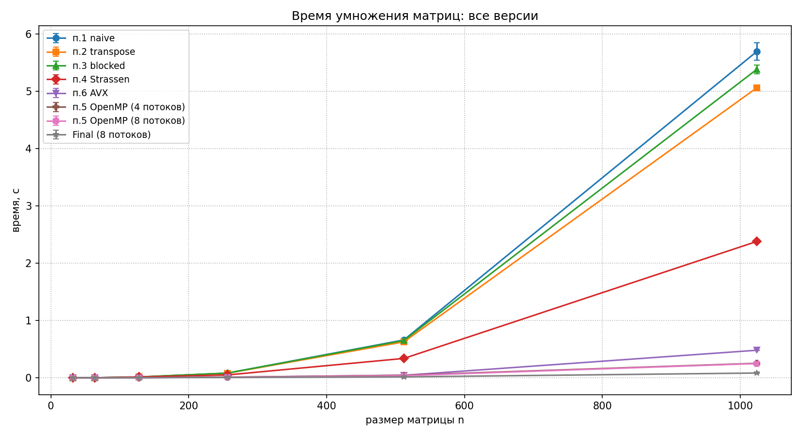
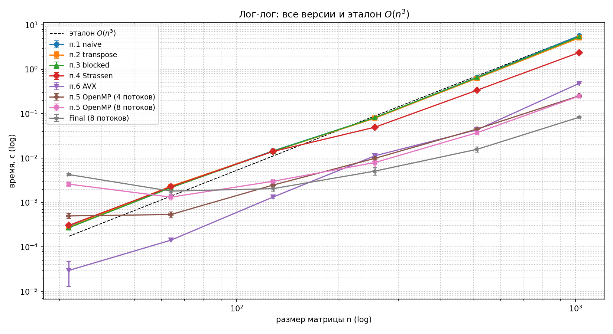
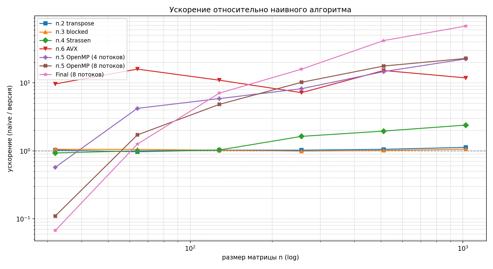

# Умножение матриц: наивный алгоритм и оптимизации

Сравнение семи версий умножения квадратных матриц (C) на размерах
`32…1024`: наивный, транспонирование, блочный, Штрассен, OpenMP (4/8
потоков), AVX+FMA и финальная (все оптимизации вместе). Замеры по 5
запусков, агрегация и графики — Python.

## Результаты (среднее по 5 запускам, с)

| n    | п.1 naive | п.2 transpose | п.3 blocked | п.4 Strassen | п.5 OMP-4 | п.5 OMP-8 | п.6 AVX | **Финал** |
|-----:|----------:|--------------:|------------:|-------------:|----------:|----------:|--------:|----------:|
| 32   | 0.000286  | 0.000279      | 0.000267    | 0.000306     | 0.000505  | 0.002734  | 0.000030 | 0.004258 |
| 64   | 0.002265  | 0.002335      | 0.002157    | 0.002265     | 0.000535  | 0.001334  | 0.000142 | 0.001804 |
| 128  | 0.014509  | 0.014148      | 0.014227    | 0.014100     | 0.002460  | 0.003043  | 0.001324 | 0.002050 |
| 256  | 0.081140  | 0.079259      | 0.081997    | 0.049658     | 0.010014  | 0.008589  | 0.011301 | 0.005094 |
| 512  | 0.660581  | 0.627089      | 0.651251    | 0.337997     | 0.045261  | 0.037265  | 0.043418 | 0.015752 |
| 1024 | 5.695260  | 5.061424      | 5.384028    | 2.379675     | 0.253697  | 0.248593  | 0.480810 | 0.083070 |

## Графики

На лог-лог графике наивная версия ложится на эталон `O(n³)`; каждая
следующая оптимизация сдвигает кривую вниз. Финал ниже naive примерно
на 1.5 порядка на `n = 1024`. На `n = 32` финал **выше** naive —
накладные расходы OpenMP на создание потоков.

